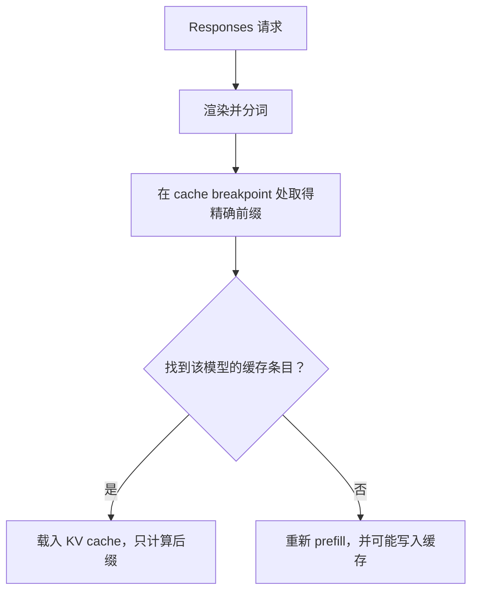
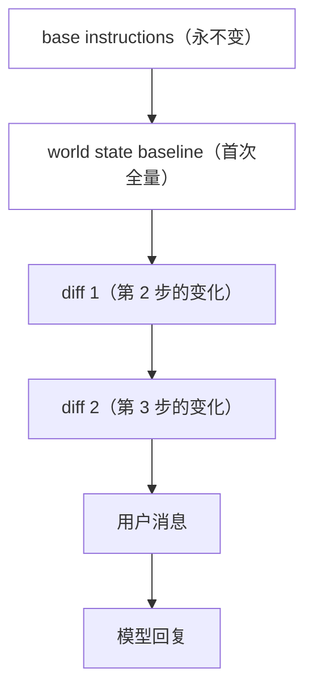
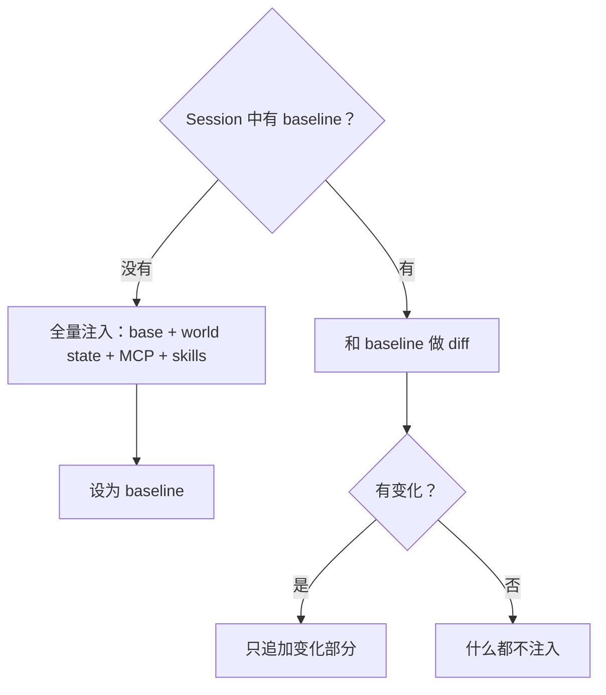

想象你在编一份报纸。每天出刊前，你要决定：头版放什么、哪些新闻是新的、哪些是昨天就有的但今天更新了、哪些广告位要换。

你不会每天把整份报纸从头写一遍。你有一个**底版**——不变的报头、固定的栏目框架。然后你往上贴**增量**：今天的新闻、更新的股价、新来的广告。底版不动，增量追加。

为什么要这样？因为印刷厂有个规矩：**如果底版变了，整条流水线要重新校准。** 校准一次很贵。底版不变，只换增量，流水线就能持续跑。

Codex 的上下文构造就是这个逻辑。模型每次被调用时看到的"system prompt"不是一个固定字符串——它是一条装配流水线的产物。而这条流水线有一个重要约束：**尽量不要改动已经发送过的前缀。**前缀稳定，服务端才有机会省掉重复的 prefill；前缀变化，这个机会就会缩小甚至消失。

## 为什么系统努力保持前缀稳定

OpenAI 的 prompt cache 会保存重复前缀在 prefill 中产生的中间状态。后续请求命中后，可以从已缓存前缀的末尾继续处理变化的后缀，减少首 token 延迟、输入计算量和费用。

这里需要把两件事分开：**用来匹配的是 prompt 前缀，命中后复用的是 KV cache。**服务端不会拿本次请求生成的 KV tensor 去和缓存逐个比较；它先把请求渲染、分词，在缓存断点处用精确前缀及其缓存键查找已有条目。条目中保存的值，才是模型各注意力层在 prefill 时产生的 key/value tensors。

概念上可以把一次查找理解成：

```text
查找条件 ≈ 模型 + prompt_cache_key + 精确的渲染后前缀
缓存内容 = 这个模型为该前缀计算出的 KV tensors
```

这不是服务端内部缓存键格式的复刻——相关实现不在 `openai/codex` 仓库中——而是解释客户端必须维护哪些条件。官方文档只确认 `prompt_cache_key` 会和前缀 hash 一起影响路由，缓存内容是 prefill 生成的 KV tensors。

因此，“相同前缀”也不宜写成“用户输入的字符串逐字节相同”。参与渲染的 instructions、消息、工具定义、图片等都可能影响结果。真正重要的是：到缓存断点为止，服务端看到的 prompt 前缀必须精确一致。



Codex 给每个普通请求附带 `prompt_cache_key`。`ModelClient::prompt_cache_key` 默认返回 session ID；构造 Responses 请求时，它和当前 `model`、`instructions`、`input`、`tools` 一起发送。它帮助相似请求被路由到合适的缓存位置，不是某一份 KV cache 的唯一句柄。

按照 OpenAI 当前的 [Prompt Caching 文档](https://developers.openai.com/api/docs/guides/prompt-caching)，GPT-5.6 在 cache breakpoint 上匹配精确前缀；默认断点位于最新的 user 或 tool 消息，而且不会自动退回更早的未标记公共前缀。显式标记稳定边界后，断点后的内容才可以变化而不影响前面的条目。

在本书核对的源码快照中，`ResponsesApiRequest` 会发送 `prompt_cache_key`，但还没有 `prompt_cache_options` 或 `prompt_cache_breakpoint` 字段。因此追加式历史只完成了一件必要但不充分的事：**保留可复用前缀。**最终命中多少 token，仍由服务端的模型隔离、breakpoint、路由和淘汰状态决定。

客户端能控制的规则仍然很清楚：**不变的信息放前面，变化的信息追加在后面。**这样至少不会在稳定内容中间制造新的分叉。



base instructions 和 baseline 在整个 turn 中保持不变，变化只追加在尾部。这保留了 cache 命中的机会，但不承诺服务端一定命中。

## 每步都重新"采访"，但不是每步都"见报"

每个 model step 之前，`capture_step_context` 会重新收集所有环境信息：

- AGENTS.md（可能因为工作目录切换而变化）
- MCP 工具列表（可能因为 server 启动/关闭而变化）
- 环境选择（workspace roots、cwd）
- 能力发现（executor capabilities）

用报纸类比：记者每步都出去采访（重建 WorldState），但只有采访到了**新东西**，才会见报（注入上下文）。如果环境完全没变，这步什么都不追加。

## 没有 baseline 时全量，有 baseline 后增量

Session 的第一个 Turn（或者 rollback 裁掉了包含初始上下文的 developer bundle 时），系统做一次全量注入：base instructions、完整的 world state、MCP 工具列表、可用 skills。这是“底版”。注入完成后，当前快照成为 baseline。

从第二个 Turn 开始，baseline 已经存在于 Session 中。后续每步只做 diff：和 baseline 比较，只注入变化的部分。baseline 跨 Turn 保留，不需要每个 Turn 重新全量。



什么时候 baseline 会重置？Compaction 会在压缩过程中同步安装新的 baseline（不是清空后等下一步重建，而是压缩完成时新 baseline 已经就位）。Rollback 裁掉初始上下文后，`reference_context_item` 被清空，下一步会重新全量注入。正常对话中，baseline 从第一个 Turn 建立后就一直延续。

这不只是为了缩短本次输入。核心目的是**不改写已经形成的前缀**。如果每步都把动态环境重新塞回历史前部，后续内容的位置和渲染结果都会变化，原有缓存条目很难继续匹配。只追加 diff，至少让旧历史保持为新历史的前缀。

## 上下文的来源清单

从源码的 `context/` 目录可以看到所有注入来源：

| 来源 | 注入时机 | 变化频率 |
|------|----------|----------|
| 基础指令 | 首次全量 | 整个 session 不变 |
| AGENTS.md | 每步检查 | 偶尔（cd 或文件修改） |
| 权限说明 | 配置变化时 | 很少 |
| 环境信息（cwd、权限、子 agent 列表等） | 每步 | 经常 |
| 可用 skills | 首次或变化时 | 偶尔 |
| MCP 工具 | 每步重建 | 偶尔 |
| 子 agent 列表 | 每步（baseline/diff） | 经常（多 agent 模式） |
| 时间提醒 | 周期性 | 固定间隔 |

注意变化频率的差异：base instructions 整个 session 不变，environment cwd 和子 agent 列表每步都可能变。如果把它们放在同一个“system prompt 模板”里，要么每步都变（cache miss），要么环境信息不更新（模型不知道环境变了）。baseline/diff 机制让不同频率的信息各得其所。

## 切换模型后，旧前缀还能用吗

模型切换最容易暴露“文本前缀”和“KV cache”不是一回事。

以 `gpt-5.6-sol` 切到 `gpt-5.6-luna` 为例，Codex 不会清空历史重新开一条对话。`build_model_instructions_update_item` 检测到 model slug 变化后，会追加一条 `<model_switch>` developer 消息，把新模型的指令放进既有历史。`prompt_cache_key` 仍然是同一个 session ID。也就是说，**历史连续性和缓存路由键都被保留了。**

但这不等于 Luna 能读取 Sol 已经计算好的 KV tensors。KV 是模型权重对特定 token 序列做前向计算的结果；即使两个模型使用相同文本、相同 tokenizer 和相同张量形状，只要权重不同，产生的数值就不同。OpenAI 的公开文档没有承诺跨模型复用 KV，Codex 源码也没有这样的协议。因此客户端必须把模型切换视为推理缓存边界，不能因为 key 和文本前缀相同就宣称跨模型命中。

WebSocket 模式还有一个更直接的边界：后续请求只有在 `responses_request_properties_match` 判定 model 相同后，才能发送 `previous_response_id` 和新增 input。模型一变，请求就回到完整输入路径。这里失效的是 Responses 状态复用，不等同于 prompt cache，但它同样说明：**切模型不能假设服务端中间状态仍兼容。**

Sol 和 Luna 在当前 `models.json` 中恰好都有 272K context window，`comp_hash` 也都是 `3000`。这个相同值只让 `maybe_run_previous_model_inline_compact` 判断两者不需要因为压缩兼容性变化而先做一次 compaction。它描述的是“旧历史能否按新模型接受的格式继续携带”，不是“旧模型 KV 能否交给新模型”。

频繁来回切换的代价很具体：新模型可能需要重新 prefill；切回旧模型时，历史又已追加另一模型的输出和 `<model_switch>`，当前隐式 breakpoint 的精确前缀也变了。结果可能是更多非缓存输入、缓存写入和首 token 延迟，也会让两套模型池分别承担相似历史的计算与缓存压力。

判断影响时不要看 `prompt_cache_key` 是否相同，而要看服务端返回的 usage。Codex 把 `input_tokens_details.cached_tokens` 记录为 `cached_input_tokens`，把 `cache_write_tokens` 记录为 `cache_write_input_tokens`。这是区分“客户端保留了命中条件”和“服务端实际命中了多少”的唯一可靠证据。

## 代价

这套机制的代价很具体：

**你无法打开一个文件看到"模型看到的完整 system prompt"。** 它不存在于任何一个地方。它是 baseline + 所有 diff 的叠加结果。调试"为什么模型不知道 X？"需要追踪 X 的注入条件和 diff 逻辑。

**实现复杂度。** baseline/diff 比"每次全量拼"复杂得多。需要维护 baseline、做 diff、处理 baseline 重置（compaction 后，见 ch05）。

**但换来的是：** 一个长 turn 里，旧历史稳定地保留为新历史的前缀，服务端因而拥有复用 prefill 的条件。如果每步都改写已有上下文，这个条件会被客户端主动破坏。至于最终节省多少，必须以服务端返回的 cached input 和 cache write 指标为准。

## 一句话总结

上下文不是一个字符串，是一条装配线。策略是“首次全量、后续追加 diff”，目的是保留稳定前缀和缓存命中的机会。匹配的是精确 prompt 前缀，命中后复用的是当前模型的 KV cache；一旦切换模型，历史可以延续，中间推理状态却不能被客户端视为兼容。

---

源码快照：`openai/codex` @ `841e47b8fb113a201b68e0f1f5790ba22836a241`（`codex-rs/core/src/client.rs`、`core/src/context_manager/updates.rs`、`core/src/session/mod.rs`、`models-manager/models.json`）
